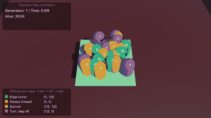

# Genetik Algoritmalarla Hareketin Evrimi: Stay on Platform (Unity 6.3)

BLM5026 Bilgisayar Oyunlarında Yapay Zeka · Rapor 6 (Hafta 7) · Veysel Uğurlu
Bursa Teknik Üniversitesi, Bilgisayar Mühendisliği Yüksek Lisans · Doç. Dr. İzzet Fatih Şentürk



Platformdaki 24 botun her birinin iki geni var: önünde zemin varken ne yapacağı ve önünde boşluk varken ne yapacağı (ileri, sola dön, sağa dön). 8 saniye sonunda en uzun yaşayan ve en çok yol alan botlar ebeveyn oluyor. Birkaç nesil içinde "zeminde ilerle, kenara gelince dön" davranışı kendiliğinden ortaya çıkıyor.

| Deney (30 nesil, aynı 10 seed) | 1. nesil ort. fitness | 30. nesil ort. fitness | 30. nesilde kenarda dönen payı |
|---|---|---|---|
| Mutasyon %0 | 8.75 | 15.65 | %100 |
| Mutasyon %10 | 8.75 | 14.23 | %84 |
| Mutasyon %30 | 8.75 | 12.21 | %60 |
| Starter (kalıtım yok) | 8.75 | 9.03 | %26 |

Ayrıntılı açıklama, kodlar, etkinlikler ve tüm deneyler: **[docs/week07/README.md](docs/week07/README.md)**

## Çalıştırma

1. Unity Hub → Add project from disk → bu klasör (Unity 6000.3.x).
2. `Assets/StayOnPlatform2026/Scenes/StayOnPlatform.unity` → **Play**.
3. Sahneyi yeniden kurmak için: **Tools → AI Games Week 3 → Create Stay On Platform Scene**.

## Proje yapısı

```
Assets/StayOnPlatform2026/Scripts/   DNA, Brain, PopulationManager, DeathZone,
                                     GenomeColors, StrategyLegend, ExperimentDriver
Assets/StayOnPlatform2026/Editor/    sahne kurucu, DNA kontrolleri, rapor görüntüleri
Assets/StayOnPlatform2026/Prefabs/   Bot.prefab
Assets/StayOnPlatform2026/Scenes/    StayOnPlatform.unity
docs/week07/                         rapor sayfası, grafikler, deney verisi
tools/                               deney, grafik ve animasyon scriptleri (Python)
```

Her hafta ayrı bir `feature/...` dalında geliştirilir ve Pull Request ile `main` dalına birleştirilir.
