# Rapor 6 (Hafta 7): Genetik Algoritmalarla Hareketin Evrimi

BLM5026 Bilgisayar Oyunlarında Yapay Zeka · Veysel Uğurlu · Unity 6.3 LTS (6000.3.25f1) · Universal 3D

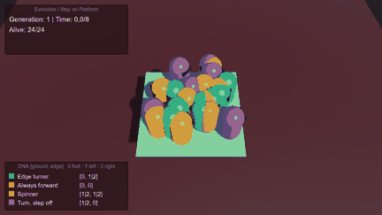

*Seed 2026, mutasyon %10. Yeşil kapsüller kenara gelince dönen ajanlar; ikinci nesilden itibaren popülasyonun büyük kısmı platform kenarında tur atıyor. Gri kapsüller düşüp ölenler.*

---

## 1. Bu hafta ne yapıldı?

Küçük bir platformun üstünde 24 kapsül (bot) var; platformun altında bir "ölüm zemini" bulunuyor. Her botun yalnızca iki geni var: önünde zemin varken ne yapacağı (g0) ve önünde boşluk varken ne yapacağı (g1). Her gen üç eylemden birini seçiyor: 0 ileri, 1 sola dön, 2 sağa dön. Bot 8 saniye boyunca bu iki kurala göre hareket ediyor; sonunda hem ne kadar yaşadığına hem ne kadar yol aldığına göre puan alıyor. En iyi bireyler bir sonraki neslin ebeveyni oluyor.

Kimse bota "kenara gelince dön" demiyor. Bu davranış seçilim, çaprazlama ve mutasyonla 3-4 nesilde kendiliğinden ortaya çıkıyor.

| Ne | Sonuç |
|---|---|
| TODO A-D | Çaprazlama, mutasyon, raycast sensörü ve yeni nesil üretimi tamamlandı (bölüm 4) |
| 9 etkinlik ve 5 kısa soru | Hepsi cevaplandı (bölüm 4 ve 7) |
| Kontrollü deney | 3 mutasyon oranı + starter, 30 nesil, **aynı 10 seed** (2026-2035) |
| Mutasyon %0 / %10 / %30 | 30. nesilde ortalama fitness 15.65 / 14.23 / 12.21; starter (kalıtım yok) 9.03 |
| Fitness tasarımı | Yalnız yaşam süresi ödüllendirilince popülasyonun %64'ü yerinde dönen botlarda kalıyor |
| Tekrarlanabilirlik | Aynı seed ile iki koşu birebir aynı CSV'yi verdi |

## 2. Temel kavramlar

| Kavram | Bu projedeki karşılığı |
|---|---|
| Birey | Bir kapsül bot (`Bot.prefab`, `Brain.cs`) |
| Kromozom / genotip | `[g0, g1]`, iki tamsayı (`DNA.cs`) |
| Gen değeri | Eylem kodu: 0 ileri, 1 sola dön, 2 sağa dön |
| Fenotip | Genlerin sahnedeki karşılığı: botun hareketi |
| Sensör | Gözün 1.1 birim önünden aşağı atılan ışın (raycast) |
| Fitness | `timeAlive + 0.55 × distanceMoved` |
| Seçilim | Fitness'a göre sıralama, en iyi 2 birey aynen kopyalanır (elitizm), ebeveynler en iyi yarıdan (12 birey) seçilir |
| Çaprazlama | Tek noktalı: g0 ebeveyn A'dan, g1 ebeveyn B'den |
| Mutasyon | Her gen %10 olasılıkla **farklı** bir eyleme geçer |
| Nesil | 8 saniyelik deneme; 24 birey |

**GA ve GP farkı:** Burada evrilen şey sabit uzunlukta bir sayı dizisi (`[g0, g1]`), yani bu bir genetik algoritmadır. Genetik programlamada ise `EĞER önde zemin varsa İLERİ, değilse SOLA DÖN` gibi bir program ağacının kendisi (koşullar, dallar, eylemler) evrilir. Bu projede koşul yapısı sabit; yalnızca iki yapraktaki eylemler değişiyor. Olası strateji sayısı da yalnızca 3² = 9.

### Dört strateji ailesi

Dokuz DNA, davranışına göre dört gruba ayrılıyor. Sahnede ve grafiklerde aynı renkler kullanıldı.

| Renk | DNA | Davranış |
|---|---|---|
| Yeşil | `[0, 1]`, `[0, 2]` | Zeminde ileri, kenarda döner: platform kenarında tur atar |
| Kırmızı | `[0, 0]` | Her durumda ileri: kenardan düşer |
| Sarı | `[1, 1]`, `[1, 2]`, `[2, 1]`, `[2, 2]` | Her durumda döner: yerinde döner, hiç ilerlemez |
| Mor | `[1, 0]`, `[2, 0]` | Zeminde döner, boşluk görünce ileri gider: kenara yakınsa düşer |

## 3. Sahne ve mimari

```
StayOnPlatform (sahne)
├── Main Camera
├── Directional Light
├── SafePlatform        Plane (5 × 5) + MeshCollider
├── DeathFloor          Cube + BoxCollider + DeathZone (tag kullanılmadı)
├── PopulationManager   PopulationManager + StrategyLegend + ExperimentDriver
└── (Play sırasında) Bot_G<nesil>_<sıra> × 24

Bot.prefab
├── Capsule + CapsuleCollider + Rigidbody (X/Z dönüşü kilitli, Interpolate) + Brain + GenomeColors
└── Eyes_ProbeOrigin    Cube, collider yok, yerel konum (0, 0.52, 0.40)
```

| Dosya | Görev |
|---|---|
| `Scripts/DNA.cs` | İki genli kromozom, `Cross`, `Mutate` (TODO A, B) |
| `Scripts/Brain.cs` | Sensör, eylem seçimi, fitness (TODO C) |
| `Scripts/PopulationManager.cs` | Nesil döngüsü, sıralama, elitizm, ebeveyn seçimi (TODO D) |
| `Scripts/DeathZone.cs` | Ölüm zeminini işaretleyen boş bileşen |
| `Scripts/GenomeColors.cs`, `StrategyLegend.cs` | Botu stratejisine göre boyar, köşede renk açıklaması çizer |
| `Scripts/ExperimentDriver.cs` | Build'i komut satırından deney ya da kare kaydı modunda çalıştırır |
| `Editor/StayOnPlatformSceneBuilder.cs` | Sahneyi, prefab'ı, malzemeleri ve build'i kurar |
| `Editor/DnaChecks.cs` | Çaprazlama ve mutasyon sonuçlarını 100 000 denemeyle sayar |
| `Editor/ReportScreenshots.cs` | Rapordaki Editor ekran görüntülerini alır |

Sahne dışarıdan hiçbir asset kullanmadan kod ile kurulur: Unity menüsünde **Tools → AI Games Week 3 → Create Stay On Platform Scene**.

### Unity Editor'dan görüntüler

| | |
|---|---|
| 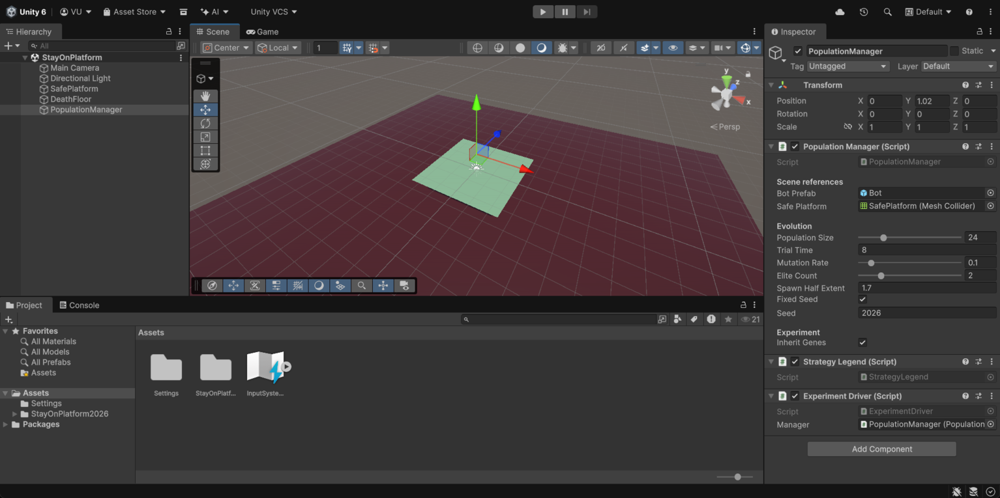 | 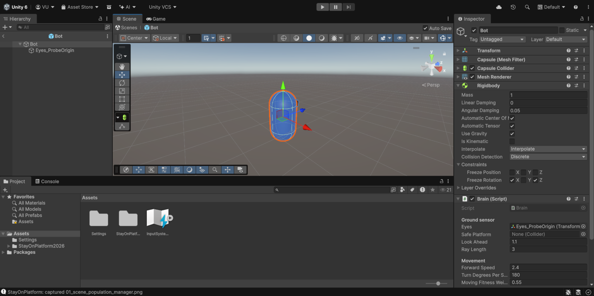 |
| *Sahne hiyerarşisi ve PopulationManager ayarları* | *Bot prefab'ı: Rigidbody (X/Z kilitli) ve Brain* |
| 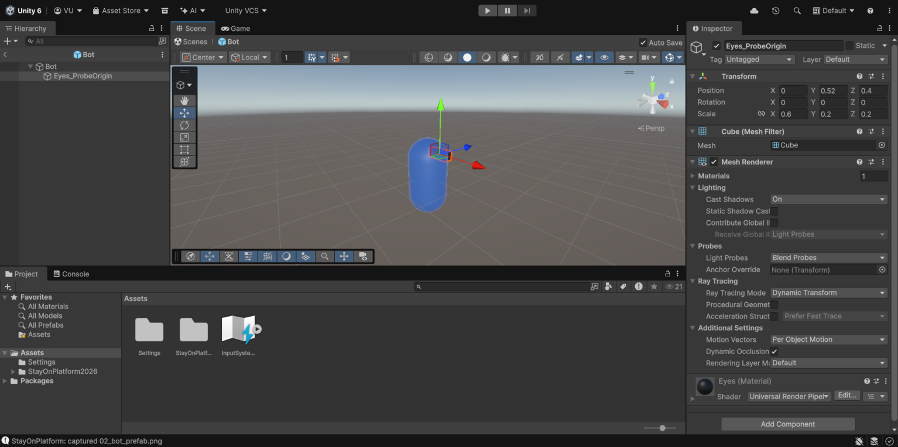 | 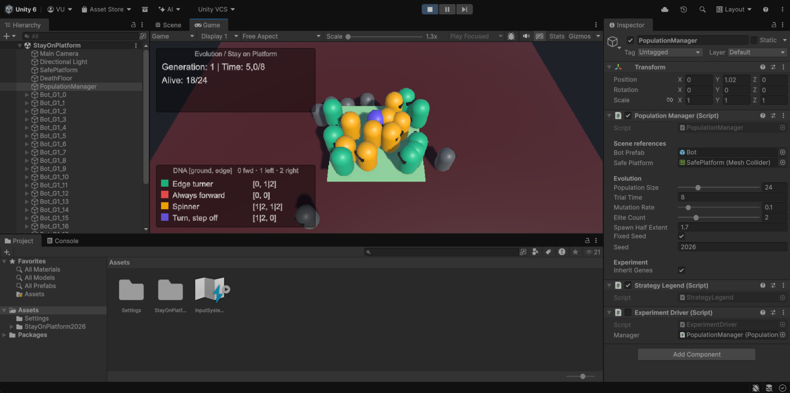 |
| *Eyes_ProbeOrigin: konum (0, 0.52, 0.40), collider yok* | *Play modu, 1. nesil* |
| 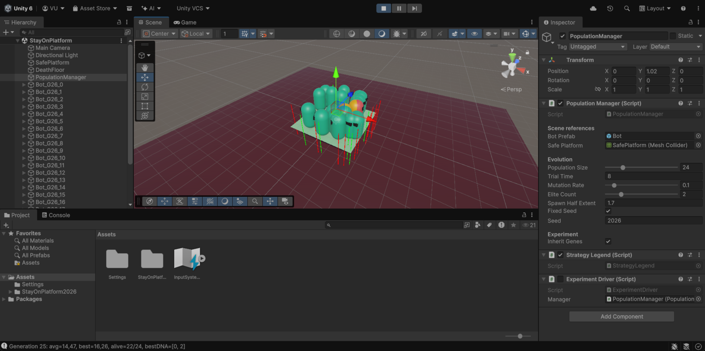 | 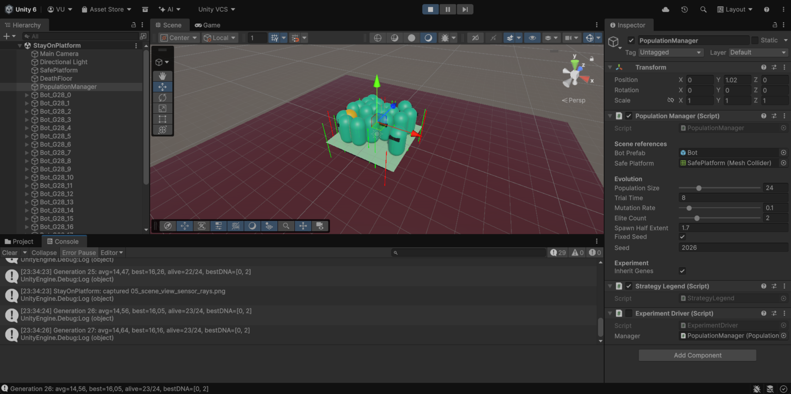 |
| *Scene görünümü: yeşil ışın zemin, kırmızı ışın boşluk* | *Console: her neslin ortalama/en iyi fitness'ı ve en iyi DNA'sı* |

## 4. Etkinlikler ve TODO'lar

| Etkinlik | İstenen | Nerede / cevap |
|---|---|---|
| 1. Genotipten davranışa | `[0, 2]` ve `[1, 1]` nasıl davranır? | `[0, 2]`: zeminde ileri, kenarda sağa döner. `[1, 1]`: her durumda sola döner; 8 s yaşar ama hiç yol almaz (ölçülen mesafe 0.0) |
| 2. Sahne bileşenleri | Dış asset olmadan sahne | `StayOnPlatformSceneBuilder`; ölüm zemini `DeathZone` bileşeniyle tanınır |
| 3. Bot ve Eyes | Rigidbody, X/Z kilidi, collider'sız göz | `Bot.prefab`; gözde collider olsaydı botun fiziğine katılır ve ışınlar ona çarpabilirdi |
| 4. Raycast (TODO C) | İleriden aşağı ışın, yalnız güvenli platform | `Brain.SenseGroundAhead` |
| 5. Çaprazlama (TODO A) | A = [0, 1], B = [2, 2] → ? | `DNA.Cross` → `[0, 2]` (ölçüldü: `data/dna_checks.json`) |
| 6. Mutasyon (TODO B) | %10, yeni değer eskisinden farklı | `DNA.Mutate`, `(gen + Range(1, 3)) % 3` |
| 7. Eylem seçimi | Zemin varsa g0, yoksa g1 | `Brain.FixedUpdate`, `MovePosition` / `MoveRotation` |
| 8. Fitness eleştirisi | Yalnız yaşam süresi / aşırı mesafe ödülü | Bölüm 5.3'te deneyle cevaplandı |
| 9. Yeni nesil (TODO D) | 2 elit + 22 çocuk = tam 24 | `PopulationManager.BuildNextGenomes` |

### TODO C: sensör

```csharp
Vector3 origin = eyes.position + transform.forward * lookAhead;
bool found = Physics.Raycast(origin, Vector3.down, out RaycastHit hit,
                             rayLength, ~0, QueryTriggerInteraction.Ignore)
             && hit.collider == safePlatform;
```

Işın botun önündeki bir noktadan dikey olarak aşağı atılıyor. Yatay bir ışın düz zeminde hiçbir şeye çarpmayabilir; aşağı bakan ışın ise önde zemin olup olmadığını doğrudan söylüyor. Yalnızca `SafePlatform` collider'ı "zemin" sayılıyor; ölüm zemini ya da başka bir bot sayılmıyor.

### TODO A ve B: çaprazlama ve mutasyon

```csharp
public static DNA Cross(DNA parentA, DNA parentB)
    => new DNA(parentA.GetGene(0), parentB.GetGene(1));   // tek kesme noktası g0 | g1 arası

int shift = UnityEngine.Random.Range(1, 3);               // 1 ya da 2 (üst sınır hariç)
genes[i] = (genes[i] + shift) % 3;                        // her zaman farklı bir eylem
```

İki genli bir dizide kesme noktası yalnızca iki genin arasında olabilir. Çaprazlama mevcut genleri yeniden birleştirir ama yeni bir değer üretemez; yeni değeri mutasyon getirir. `[0, 2]` DNA'sına 100 000 kez %10 mutasyon uygulandığında:

| Sonuç | Ölçülen oran | Beklenen |
|---|---|---|
| `[0, 2]` (değişmedi) | 0.806 | 0.9 × 0.9 = 0.81 |
| Tek gen değişti (`[1, 2]`, `[2, 2]`, `[0, 0]`, `[0, 1]`) | her biri ≈ 0.046 | 0.1 × 0.9 / 2 = 0.045 |
| İki gen değişti (4 olasılık) | her biri ≈ 0.003 | 0.1 × 0.1 / 4 = 0.0025 |

%0 mutasyonda DNA hiç değişmiyor; %100'de iki gen de her seferinde eski değerinden farklı oluyor. %0'ın riski çeşitliliğin kaybolması, %100'ün riski iyi genlerin her nesilde bozulmasıdır.

### TODO D: yeni nesil

```csharp
for (int i = 0; i < elite; i++) children.Add(sorted[i].dna.Copy());   // en iyi 2
int pool = Mathf.Max(2, sorted.Count / 2);                            // en iyi 12
while (children.Count < populationSize)                              // tam 24'te durur
{
    DNA a = sorted[UnityEngine.Random.Range(0, pool)].dna;
    DNA b = sorted[UnityEngine.Random.Range(0, pool)].dna;
    DNA child = DNA.Cross(a, b);
    child.Mutate(mutationRate);
    children.Add(child);
}
```

Yeni genomlar eski botlar silinmeden önce kopyalanıyor; `Destroy` kare sonunda çalıştığı için yeni nesil bir kare sonra oluşturuluyor.

### Fizik

Hareket `Update` yerine `FixedUpdate` içinde, `Rigidbody.MovePosition` ve `MoveRotation` ile yapılıyor. Böylece bot her fizik adımında aynı mesafeyi alıyor; ekranın saniyede kaç kare çizdiği davranışı değiştirmiyor. Düşme ise fizik motorunun yerçekimine bırakıldı. Bot ölünce `timeAlive` sıfırlanmıyor; o ana kadar biriken süre fitness'ta kalıyor.

## 5. Kontrollü deneyler

Tek bir başarılı nesil kanıt sayılmadığı için her koşul **aynı 10 seed** (2026-2035) ile 30'ar nesil çalıştırıldı. Aynı seed, her koşulda aynı başlangıç genomlarını ve aynı doğma konumlarını veriyor; koşullar arasındaki tek fark incelenen ayar. Sabit tutulanlar: platform 5 × 5, popülasyon 24, deneme 8 s, 2 elit, ebeveyn havuzu en iyi 12.

Deneyler Windows build'i ile, pencere açılmadan çalıştırıldı ([tools/run_experiments.py](../../tools/run_experiments.py)). Her karede oyun zamanı tam bir fizik adımı (0.02 s) ilerliyor; bu yüzden sonuç bilgisayarın hızından bağımsız ve tekrarlanabilir. Kontrol için aynı koşu iki kez çalıştırıldı ve CSV satırları birebir aynı çıktı ([data/repeat_check.txt](data/repeat_check.txt)). Ham veri: [data/generations.csv](data/generations.csv), özet: [data/summary.json](data/summary.json), örnek nesil logu: [data/log_mut0.10_seed2026.txt](data/log_mut0.10_seed2026.txt).

### 5.1 Dokuz DNA'nın davranışı

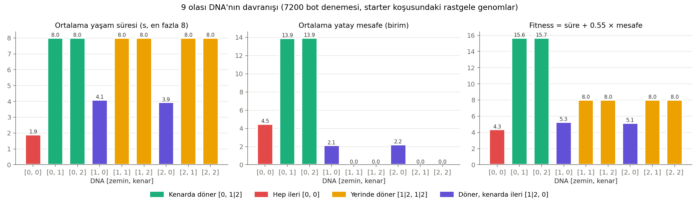

Starter koşusunda her nesil rastgele genomlarla başladığı için 7 200 bot denemesi dokuz DNA'nın davranışını doğrudan ölçmeye yetti. Kenarda dönenler (`[0, 1]`, `[0, 2]`) hem 8 s'nin tamamını yaşıyor hem 13.9 birim yol alıyor; en yüksek fitness onların (15.6). Yerinde dönenler de hep hayatta kalıyor ama hiç yol almıyor (fitness 8.0). Hep ileri giden `[0, 0]` ortalama 1.9 s'de düşüyor.

### 5.2 Üç mutasyon oranı ve starter

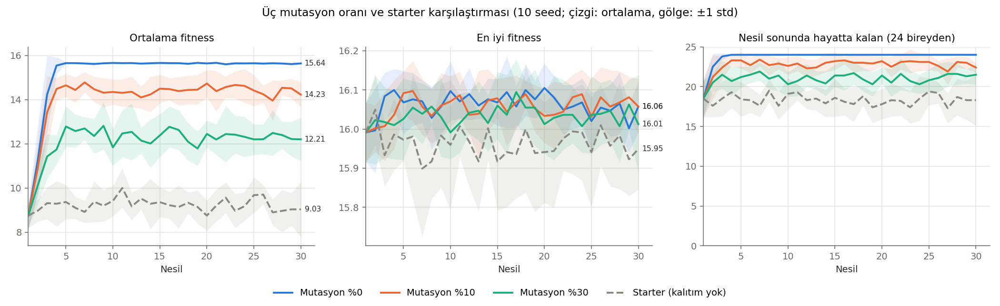

| Koşul | 1. nesil ort. fitness | 30. nesil ort. fitness | 30. nesil en iyi | 30. nesilde hayatta | 30. nesilde kenarda dönen payı | %75 eşiğine ulaşılan nesil |
|---|---|---|---|---|---|---|
| Mutasyon %0 | 8.75 ± 0.59 | 15.65 ± 0.04 | 16.06 ± 0.07 | 24.0 / 24 | %100 | 3.2 (2-4) |
| Mutasyon %10 | 8.75 ± 0.59 | 14.23 ± 0.60 | 16.06 ± 0.07 | 22.4 / 24 | %84 | 3.4 (3-5) |
| Mutasyon %30 | 8.75 ± 0.59 | 12.21 ± 1.04 | 16.01 ± 0.13 | 21.5 / 24 | %60 | 7.5 (3-16) |
| Starter (kalıtım yok) | 8.75 ± 0.59 | 9.03 ± 1.31 | 15.95 ± 0.11 | 18.3 / 24 | %26 | hiçbir seed'de |

*10 seed'in ortalaması ± standart sapması. Son sütun: popülasyonun en az %75'inin kenarda dönen olduğu ilk nesil (ortalama, en az-en çok).*

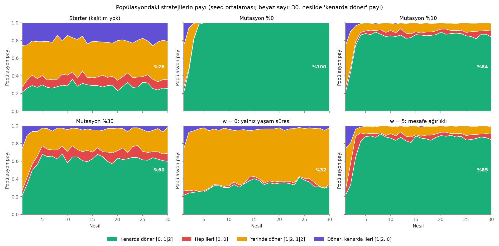

- **Starter:** Elitler dışındaki 22 birey her nesil yeniden rastgele. Ortalama fitness 30 nesil boyunca 9 civarında kalıyor; öğrenme yok.
- **Mutasyon %0:** En hızlı ve en temiz yakınsama. Bu problemde 9 strateji var ve 24 rastgele bireyden en az birinin kenarda dönen olma olasılığı 1 − (7/9)²⁴ ≈ 0.998. En iyi çözüm daha ilk nesilde bulunuyor; seçilim ve çaprazlama onu yaymaya yetiyor. Daha büyük bir arama uzayında mutasyonsuz popülasyon, ilk nesilde olmayan bir çözümü hiç bulamazdı.
- **Mutasyon %10:** Her nesilde çocukların yaklaşık %19'unda en az bir gen değişiyor. Bu bozulan çocuklar ortalamayı 15.65'ten 14.23'e çekiyor; en iyi fitness ise değişmiyor.
- **Mutasyon %30:** Yakınsama yavaşlıyor ve bir seed'de 16. nesle kadar uzuyor. 30. nesilde popülasyonun %29'u hâlâ yerinde dönüyor.

Yüksek mutasyon daha fazla çeşitlilik getiriyor ama bu ortamda ortalama fitness'ı düşürüyor. En iyi fitness ise elitizm sayesinde her mutasyon oranında yaklaşık 16'da kalıyor.

### 5.3 Fitness tasarımı (Etkinlik 8)

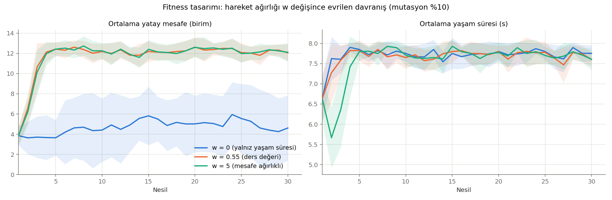

| Fitness | 30. nesil ort. mesafe | 30. nesilde kenarda dönen | 30. nesilde yerinde dönen | 2. nesilde hep ileri payı |
|---|---|---|---|---|
| `timeAlive` (w = 0) | 4.61 ± 3.40 | %32 | %64 | %2.5 |
| `timeAlive + 0.55 × mesafe` | 12.05 ± 0.86 | %84 | %9 | %4.6 |
| `timeAlive + 5 × mesafe` | 12.10 ± 0.96 | %85 | %8 | %24.2 |

- **Yalnız yaşam süresi:** Kenarda dönen ve yerinde dönen botların ikisi de 8 s yaşıyor, fitness'ları eşit. Seçilim aralarında ayrım yapamıyor; popülasyonun çoğu hareketsiz kalıyor. "Hayatta kal" hedefi tek başına hareket etmeyi öğretmiyor.
- **Aşırı mesafe ödülü:** w = 5'te hep ileri giden `[0, 0]` (1.9 s yaşayıp 4.5 birim gidiyor) fitness 24 alıyor; yerinde dönen ve 8 s yaşayan bot ise 8. Yani ölen bot, yaşayan bottan daha iyi sayılıyor. Bu yüzden ilk nesillerde düşen botlar seçiliyor: 2. nesilde hep ileri gidenlerin payı %24, ortalama yaşam süresi 5.7 s'ye iniyor. Kenarda dönenler daha da yüksek puan aldığı için sonunda onlar baskın oluyor. Eşik değeri: w > (8 − 1.89) / 4.46 ≈ 1.37 olduğunda düşmek, yerinde durmaktan daha karlı hale geliyor.
- **Eklenebilecek metrik:** Platformun ne kadarını gezdiği (ziyaret edilen hücre sayısı). Mesafe ödülü kenarda sonsuz tur atmayı da ödüllendiriyor; kapsama ölçüsü platformun içini de keşfetmeyi ödüllendirirdi.

## 6. Sınırlılıklar

- Politika uzayı küçük: yalnızca 9 strateji var. Engel, hız ya da bakış mesafesi için gen yok.
- Fitness istismara açık: ağırlık yanlış seçildiğinde yerinde dönmek ya da düşmek ödüllendirilebiliyor (bölüm 5.3).
- Botlar birbirine çarpmıyor ama sensör ışını başka bir bota çarpabiliyor. Bu durumda bot, önünde boşluk varmış gibi dönüyor. Kalabalık başlangıçta bu bir gürültü kaynağı.
- Sonuçlar bu ayarlara bağlı (5 × 5 platform, 24 birey, 8 s). Seed, doğma konumu ve fizik sonucu etkiliyor; bu yüzden 10 seed ile ölçüldü.
- Bu bir genetik programlama örneği değil: koşul yapısı sabit, yalnızca iki eylem evriliyor.

## 7. Kısa sorular ve cevapları

1. **`[2, 0]` genlerinin iki koşuldaki karşılığı?** Önde zemin varsa sağa döner; önde boşluk varsa ileri gider. Ölçümde bu DNA'lı botların yalnızca %33'ü hayatta kaldı.
2. **Raycast'in origin ve direction parametreleri?** Origin ışının başladığı nokta (gözün 1.1 birim önü), direction ışının yönü (`Vector3.down`).
3. **`timeAlive` ölümde sıfırlansaydı?** Düşen her botun fitness'ı yalnızca mesafeden oluşurdu; 7 s yaşayıp düşen bot ile ilk saniyede düşen bot arasındaki fark silinir, seçilim çarpılırdı.
4. **Elitizm ile mutasyon farkı?** Elitizm en iyi bireyi değiştirmeden bir sonraki nesle taşır; mutasyon yeni gen değerleri dener. Biri kazanılanı korur, diğeri yeni çözüm arar.
5. **Neden GP değil GA?** Evrilen şey sabit iki genli bir karar tablosu; program ağacının yapısı değişmiyor.

## 8. Çalıştırma

1. Unity Hub → Add project from disk → depo klasörü (Unity 6000.3.x).
2. `Assets/StayOnPlatform2026/Scenes/StayOnPlatform.unity` → **Play**. Her 8 saniyede yeni nesil.
3. Sahneyi baştan kurmak için: **Tools → AI Games Week 3 → Create Stay On Platform Scene**.
4. Deneyleri tekrar üretmek için: **Tools → AI Games Week 3 → Build Windows Player**, ardından
   `python tools/run_experiments.py` ve `python tools/plot_experiments.py`.

| Ortam | Sürüm |
|---|---|
| Unity | 6000.3.25f1 (Unity 6.3 LTS), Universal 3D şablonu |
| Render pipeline | URP 17.3.0 |
| Fizik | PhysX, `Time.fixedDeltaTime` = 0.02 s |
| Grafikler | Python 3.10, matplotlib, numpy, Pillow |

## 9. Kaynaklar

- Ders sunusu: *Genetik Algoritmalarla Hareketin Evrimi* (Unity 6.3), BLM5026, 2026, ve ders ile verilen starter scriptleri.
- J. H. Holland, *Adaptation in Natural and Artificial Systems*, MIT Press, 1992.
- D. E. Goldberg, *Genetic Algorithms in Search, Optimization, and Machine Learning*, Addison-Wesley, 1989.
- J. R. Koza, *Genetic Programming*, MIT Press, 1992.
- I. Millington, *AI for Games*, 3. baskı, CRC Press, 2019.
- Unity 6.3 Scripting API: `Rigidbody.MovePosition`, `MonoBehaviour.FixedUpdate`, `Physics.Raycast`, `Time.captureDeltaTime`.
